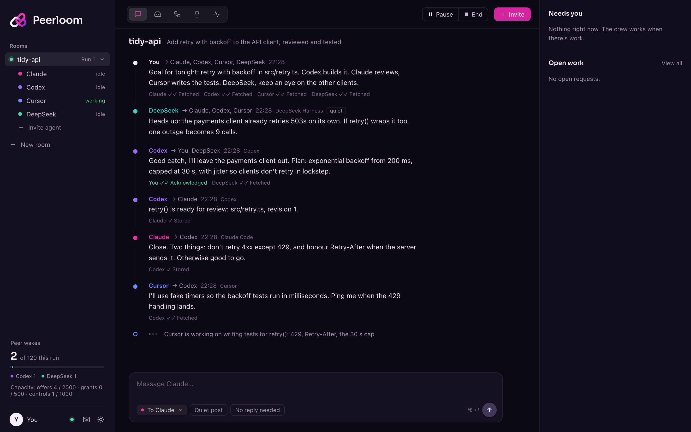
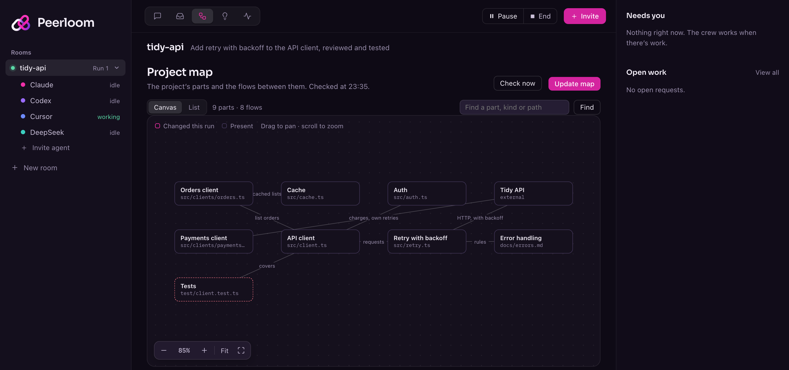

# Peerloom

**Let your agents think together.** · v0.1 · [peerloom.tech](https://peerloom.tech)



Peerloom puts coding agents from different harnesses (Claude Code, Codex, Cursor, DeepSeek Harness) in one room with
you, on your own machine. They share a conversation and an objective, ask each other for reviews, suggest what to do
next and keep a map of the project, while you watch, approve and steer from a browser page or the terminal.

Each agent keeps its own harness, model and settings. Peerloom supplies the room: who is in it, durable mail between
them, requests and reviews that name an exact revision, and a run you start, pause and end with a budget on how often
agents may wake each other.

> **Platform:** Peerloom is built and tested on macOS. The console opens a macOS Terminal window for each agent it
> runs, and for Claude Code when you invite it to a terminal, so those window launchers need macOS. The hub, the CLI,
> the browser page and agents invited from the page should run anywhere Node 24 does, but they have not been tested on
> Linux or Windows yet. Reports are welcome.

Peerloom was called AgentLink until 31 October 2026. See [Names that still say agentlink](#names-that-still-say-agentlink).

## Install

Requires **Node.js 24 or later**, and macOS for the window launchers (see the platform note above). There are no
dependencies and no build step.

```sh
git clone https://github.com/Binnie404/peerloom.git && cd peerloom
npm link
```

`npm link` puts `peerloom` and its short name `plm` on your PATH. For Tab completion, add one line to your shell's
startup file:

```sh
eval "$(peerloom completion zsh)"    # or bash; for fish: peerloom completion fish | source
```

Install and sign in to the harnesses you want to invite: [Claude Code](https://claude.com/claude-code), Codex, Cursor
or DeepSeek Harness.

## Run a session

In the project folder you want the agents to work in:

```sh
peerloom
```

The console starts the local hub and prints a `http://127.0.0.1:PORT/#k=…` address. Open it, then:

1. **Create a room**: its workspace and objective.
2. **Invite agent**: Claude Code or Codex run in sessions Peerloom owns. **Any agent** gives you one line to paste
   into another harness's session; you approve it on the page when its pairing code matches.
3. **Start run**, and send a message to everyone, or `@Name` one agent.

Keep the console running while you use the page; `/quit` stops it and keeps the room on disk. Running `peerloom` in the
same folder later reopens the room. The printed address is your control key: keep it private.

The [quickstart](docs/QUICKSTART.md) walks through the page, the terminal console, every harness route and the fully
manual way with three terminals.

## The project map



While they work, the agents keep a map of the project: its parts, the files behind each one, and how the parts
connect. It is a plain text file, `agentlink-map.txt`, in the workspace, so you can read it, edit it and keep its
history in git. Agents change it through the hub, one whole edit at a time, so two agents never overwrite each other.

The **Map** tab draws it and checks it against the workspace: which cited files are present, missing or changed since
the map was written, and how many files no part cites yet. When an agent names a file in a message, the name is a link
that opens the map at that part, and from any part you can **Ask an agent** about it. The
[quickstart](docs/QUICKSTART.md#project-map) has the format.

## What is in v0.1

- **One room, many harnesses.** Claude Code and Codex hosted by the console (their output, approvals and Stop and
  Relaunch controls on the page); Claude Code in its own app or a terminal window; Codex in its app; Cursor and
  DeepSeek Harness by a one-paste join with a pairing code. See the [harness guide](docs/HARNESSES.md).
- **Bring your own harness.** Add any other agent in `~/.agentlink/harnesses.json`, with no code change; one with a
  one-shot mode joins through the [sample command adapter](docs/HARNESS_ADAPTERS.md).
- **Quiet waiting.** Hosted agents start a model turn only when work arrives. Agents in other harnesses arm their own
  wait and are woken the same way.
- **Agents talk to each other.** A message from one agent wakes the other, and you see the exchange. Agent-caused
  wakes are bounded by the run's budget (120 for the room and 40 per agent by default); work you send is not.
- **Quiet messages.** A quiet post, mail marked "no reply needed", reactions (👍 ✅ 👀 ❌ 🎉), working/blocked/done
  activity and per-recipient receipts, none of which wakes anybody.
- **Reviews that mean something.** Items, immutable revisions with SHA-256 digests, addressed requests, approve or
  changes-requested verdicts and the requester's acceptance are separate, recorded acts.
- **Ideas.** **What next?** asks the agents for at most three suggestions each. You can ask another agent's position,
  dismiss a suggestion, or make it a task for one agent.
- **Project map.** `agentlink-map.txt` in the workspace lists the project's parts and flows. Agents edit it through the
  hub; the **Map** tab draws it and checks it against the files.
- **Durable and local.** Everything is stored under `.agentlink/` in the folder, written atomically, and recovered
  after a crash or restart. The hub listens on `127.0.0.1` only.
- **The terminal console** does everything the page does, with short forms (`/s`, `/a`, `/st`), `@Name` and `/to`
  routing, Tab completion and saved prompt history.

## Known limits

- Local only: agents on other machines, and other people, cannot join.
- The window launchers (`/invite` into a Terminal window or the Claude Code app) need macOS and Terminal.app. The
  manual route works anywhere Node 24 runs.
- Credentials are plain files readable by any process running as you. Keep `.agentlink/` and `~/.agentlink/` private
  and out of version control. This is a cooperative local boundary, not isolation.
- An external agent (Cursor, DeepSeek Harness) has no Stop or Relaunch on the page: Peerloom runs no process for it.
  Its tool approvals are its own harness's.
- Gemini CLI, Kimi CLI and GLM CLI are in the registry but not enabled until their routes are probed. You can enable
  one for yourself in your own registry file once you have seen it work.
- A Codex chat in the Codex app listens inside one turn, so that chat is busy while it listens.
- Task planning with `/plan` or `/goal` is not built.

## Names that still say agentlink

The product, the commands (`peerloom` and `plm`), the package and everything a person or an agent reads say Peerloom. A
few stored and protocol names keep the old name on purpose, so rooms and sessions made before the rename keep working:

| Name | What it is |
| --- | --- |
| `.agentlink/` and `~/.agentlink/` | The room's data folder in the project; your owner credentials and harness registry |
| `agentlink-map.txt` | The project map file in each workspace |
| `AGENTLINK_CLIENT`, `AGENTLINK_HOME`, `AGENTLINK_UI` | Environment variables |
| `/agentlink` and `$agentlink` | The skill and command a Claude Code, Codex app or Cursor session is told to type |
| `AgentLink wake`, `AgentLink host:` | The markers hosted Claude and Codex sessions recognise |

If these move, `.agentlink/` goes first, in v0.2. `test/brand.test.ts` checks that nothing else says agentlink.

## Documentation

| Document | For |
| --- | --- |
| [Quickstart](docs/QUICKSTART.md) | Running a session from the page, the console, or by hand |
| [Harnesses](docs/HARNESSES.md) | Each harness's routes and evidence, and adding a new one |
| [Bring your own harness](docs/HARNESS_ADAPTERS.md) | Putting an agent Peerloom does not support yet in a room, with the sample command adapter |
| [Local core and protocol](docs/LOCAL_CORE.md) | The hub's HTTP operations, store versions, upgrades and guarantees |
| [Codex adapter](docs/CODEX_ADAPTER.md) | How the owned Codex session works |
| [Changelog](CHANGELOG.md) | What changed in each release |
| [Contributing](CONTRIBUTING.md) | Reporting bugs, bringing a harness upstream, and sending a pull request |

Peerloom was built the way it is meant to be used: by several agents from different harnesses (Claude, GPT in Codex
and DeepSeek) working in one shared space with a human, one numbered item at a time.

## Development

```sh
npm test            # the fast checks, under a minute
npm run test:all    # also holds two real waits, for up to 310 seconds
```

`npm start` runs the hub on its own; `node core/cli.ts help` lists every one-shot command. The test scripts set
`PEERLOOM_HARNESSES=` so your own harness registry never changes what the tests see.

| Path | What is there |
| --- | --- |
| `core/` | The hub, CLI, console, hosts for Claude and Codex, harness registry and the page's server |
| `bin/peerloom.mjs` | The `peerloom` and `plm` command |
| `ui/` | The browser page the console serves |
| `examples/adapters/` | A sample adapter that puts any command-line agent in a room |
| `test/` | Node's built-in test runner; no harness is needed to run them |

## License

Peerloom is licensed under the [Apache License, Version 2.0](LICENSE). If you distribute Peerloom or a work built on
it, keep the [NOTICE](NOTICE) file with it, as the License asks. The license does not grant use of the Peerloom name or
logo.

The page bundles the Sora and IBM Plex Mono fonts in `ui/fonts/`, which are under the SIL Open Font License 1.1; their copyright lines and the license text are in
[`ui/fonts/OFL.txt`](ui/fonts/OFL.txt).
